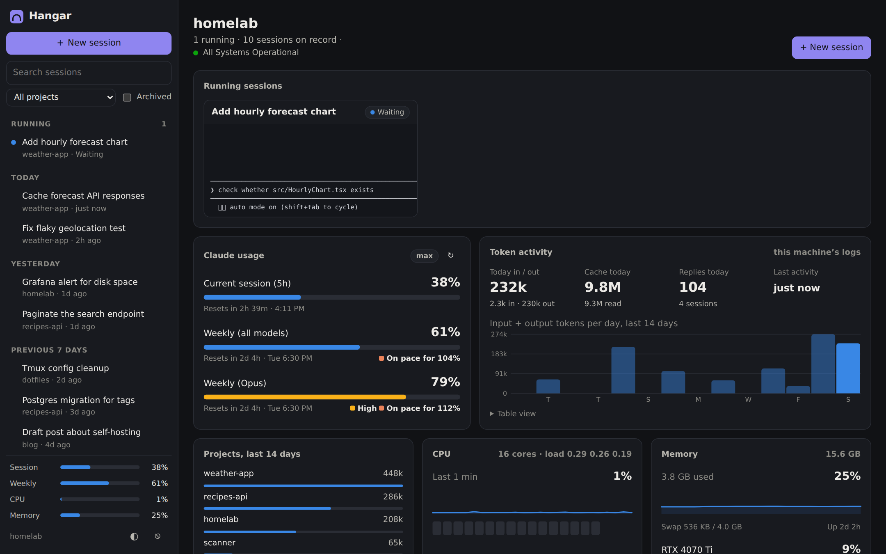
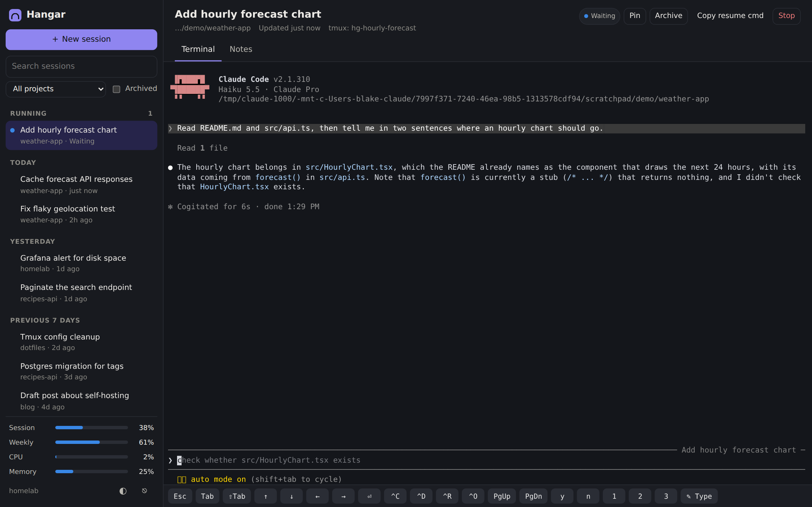
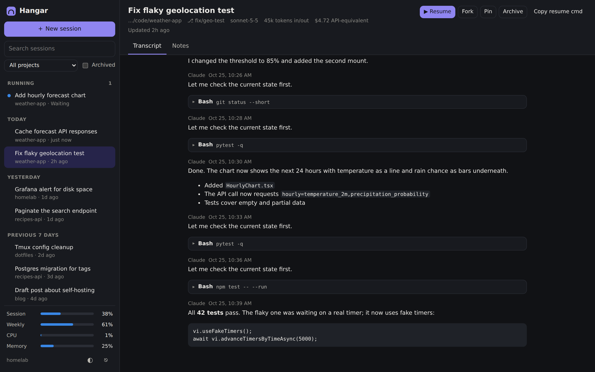
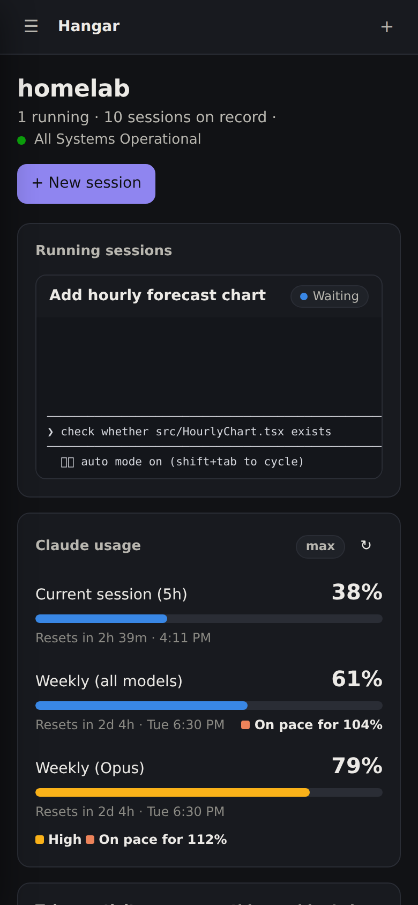
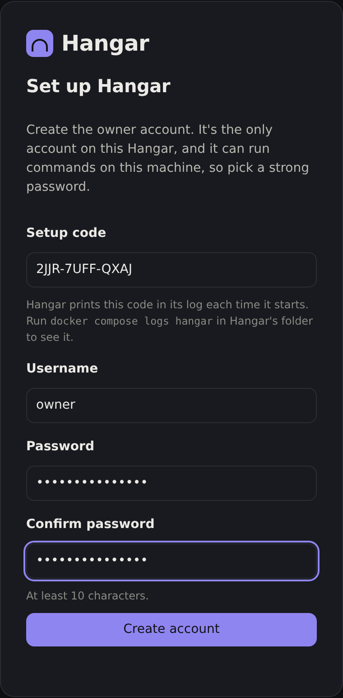
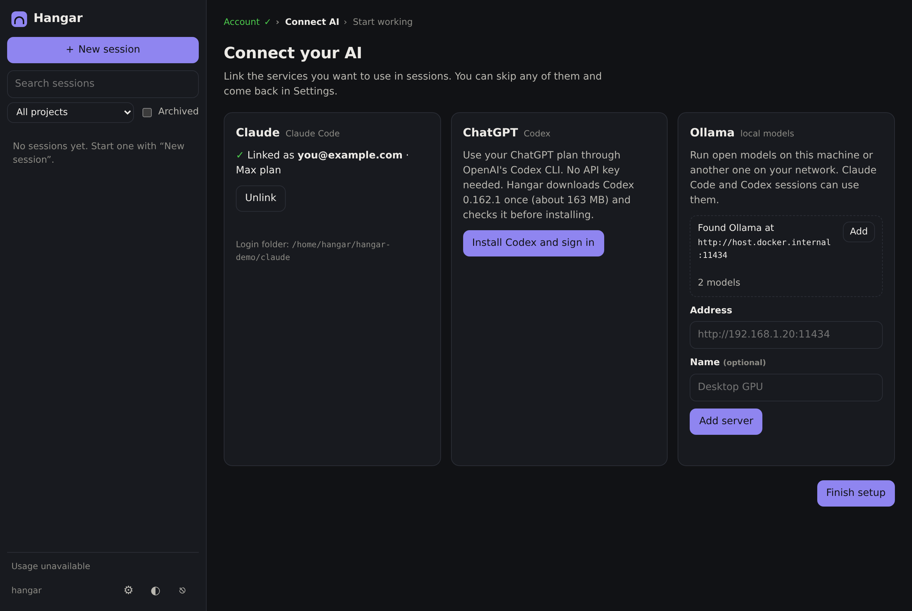
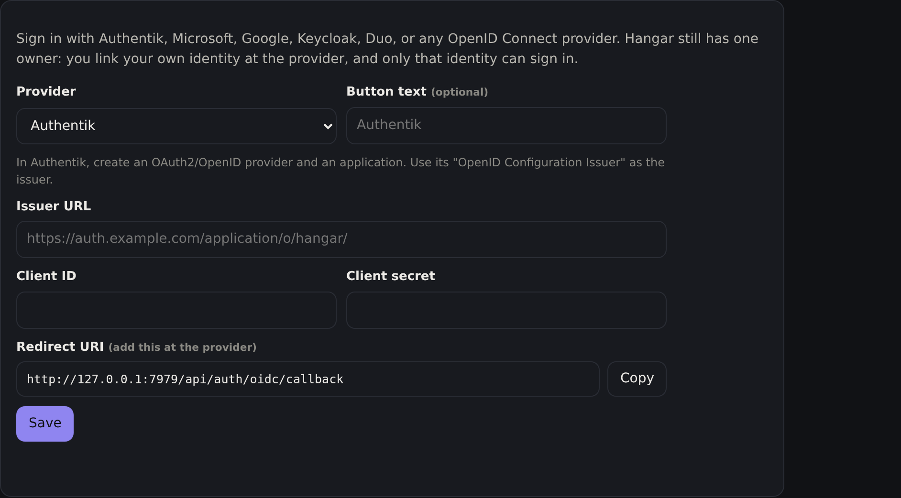
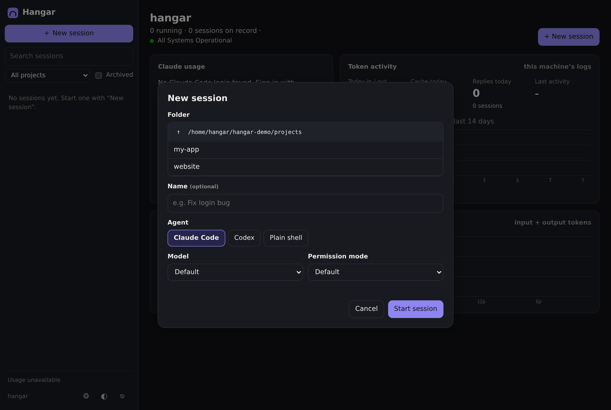

# Hangar

**Park your coding agent sessions. Pick them back up from any device.**

Hangar is a self-hosted web UI for [Claude Code](https://docs.claude.com/en/docs/claude-code/overview) and OpenAI's [Codex CLI](https://github.com/openai/codex), on your Claude or ChatGPT plan or on local models through Ollama. Every session runs inside tmux, so it keeps going when you close the browser. You can open it again from your laptop, phone, or tablet, over your home network or Tailscale. The layout follows Open WebUI: your sessions are in a sidebar, grouped by date and titled automatically. Each one has a full terminal and a readable transcript.

It also has a dashboard with your Claude and ChatGPT plan usage and token activity. On first start it walks you through creating the owner account and connecting your AI, all in the browser; you can also sign in through your own identity provider (Authentik, Microsoft, Google, Keycloak, Duo).



## Features

- **Session history.** Every Claude Code and Codex conversation on the machine, with its AI-generated title, project, git branch, token count, and cost. Search covers titles, folders, and everything you typed.
- **Live terminals in the browser.** Each session runs in its own tmux session. Attach from as many devices as you like. Closing the tab only detaches.
- **Resume anything.** Sessions that aren't running have a **Resume** button, which runs `claude --resume` (or `codex resume`) in a new tmux session. **Fork** starts a copy with a new ID.
- **Survives restarts.** When the container comes back up, Hangar can reopen the sessions that were running.
- **Transcript view.** A readable version of the conversation, with Markdown rendered and tool calls folded.
- **Works on phones.** A key bar for Esc, Shift+Tab, arrows, Ctrl+C and so on, and a compose box for long messages. You can also add it to your home screen as an app.
- **Live status.** See which sessions are working, which are waiting for you, and which have dropped back to a shell.
- **Claude usage.** Your 5-hour and weekly limits (the same numbers `/usage` shows), when they reset, and a warning when you're on pace to hit 100%. Also shows Claude status page incidents.
- **Token activity.** Daily and hourly input and output tokens from the local logs, plus the busiest projects and the models used today.
- **Claude can install what it needs.** In Docker, Claude can `sudo apt-get install` missing tools. You get a permission prompt for every sudo command, even in auto mode, and installed packages come back after the container is recreated.
- **File uploads.** Each session has a **Files** tab for its folder: upload by button or drag and drop, browse subfolders, and download what Claude made. In the terminal, **+ Attach** (or dropping a file on it) uploads into the session folder and types `@file` into Claude's prompt, so you can add a question before sending.
- **GitHub without SSH keys.** Sign in with GitHub in Settings and sessions can clone, pull, and push over HTTPS. **New session > Clone from GitHub** lists your repos and clones one into the folder you picked.
- **Pins, archive, renames, and private notes** for each session.
- **Sign in with SSO.** Optional OpenID Connect sign-in through Authentik, Microsoft Entra ID, Google, Keycloak, Duo, or any other provider.
- **Connect your AI without API keys.** Sign in with your Claude subscription, link ChatGPT through OpenAI's Codex CLI (Hangar installs it for you), and add Ollama servers on this machine or your network. All from the browser, during setup or later in Settings.

| Session terminal | Transcript | Phone |
|---|---|---|
|  |  |  |

## Quick start (Docker)

You need Docker with Compose.

```bash
git clone https://github.com/PresWiFi/hangar.git
cd hangar
cp .env.example .env
# Edit .env: set WORKSPACE to your projects folder.
docker compose up -d --build
docker compose logs hangar     # shows the one-time setup code
```

| First-run setup | Connect your AI |
|---|---|
|  |  |

Open `http://<this-machine>:7878`, enter the setup code, and create the owner account. Hangar has one account, and only someone who can read its log can create it. Next, link your AI services (see [Connecting AI](#connecting-ai)).

Forgot the password? Run `docker exec -it hangar python -m hangar reset-password`. It prints a new one and signs every device out.

**Upgrading from an earlier version:**

- Hangar creates the owner account `admin` with your `HANGAR_PASSWORD` (or the password it generated before). Sign in as `admin`, then rename the account in Settings if you like.
- Hangar now keeps its own Claude login by default instead of using the host's `~/.claude`. To keep sharing the host's login and history, add `CLAUDE_DIR=/home/you/.claude` to `.env` (the path the old default pointed at) before you run `docker compose up -d --build`.

To stop it, run `docker compose down`. Your conversations stay in Claude's and Codex's folders and can be resumed later. Run `docker compose up -d` to start it again.

To update Claude Code inside the image: `docker compose build --no-cache && docker compose up -d`. Codex is pinned to a version Hangar has been tested with and updates with Hangar.

### Windows (Docker Desktop + WSL)

Run Hangar from your WSL distro, not PowerShell, so its paths match Claude Code in WSL (and, with `CLAUDE_DIR`, it can share the same `~/.claude`):

1. In Docker Desktop, open **Settings > Resources > WSL integration** and turn it on for your distro.
2. In WSL, set `WORKSPACE` to the path WSL uses, for example `/mnt/c/Users/you/code`.
3. Run `docker compose up -d --build` from WSL.

## Reaching it from other devices

**Home network:** with the default `HANGAR_BIND=0.0.0.0`, open `http://<machine-ip>:7878` from any device on the network. You may need to allow port 7878 in the host firewall.

**Tailscale, simple:** if the host is on your tailnet, `http://<machine-tailscale-ip>:7878` works with no extra setup.

**Tailscale with HTTPS and its own name:** run the sidecar. Hangar then shows up as its own device, for example `https://hangar.your-tailnet.ts.net`.

```bash
# In .env: TS_AUTHKEY=tskey-auth-...   (and HANGAR_SECURE_COOKIES=true if you only use HTTPS)
docker compose -f docker-compose.yml -f docker-compose.tailscale.yml up -d --build
```

Turn on HTTPS certificates for your tailnet first (admin console > DNS). If you only want to reach Hangar over Tailscale, set `HANGAR_BIND=127.0.0.1` so the plain port isn't open on your network.

## Connecting AI

After setup, Hangar asks which AI services to link. You can skip any of them and come back in **Settings** (⚙ in the sidebar).

**Claude.** Click **Sign in with Claude**, sign in on claude.ai, and paste the code it shows back into Hangar. This uses your Pro or Max subscription, like `claude /login`; there's no API key. The login is stored in Hangar's Claude folder (`CLAUDE_DIR`).

**ChatGPT (Codex).** Hangar runs OpenAI's [Codex CLI](https://github.com/openai/codex) for ChatGPT. It isn't in the image: the first time you pick ChatGPT, Hangar downloads a pinned Codex release from GitHub (about 163 MB), checks its SHA-256, and installs it in Hangar's data volume, so it survives rebuilds. Then you sign in with a device code:

1. In ChatGPT, open **Settings > Security** and turn on **device code sign-in** for Codex. You only do this once.
2. Open the link Hangar shows and enter the code.

If you can't use device codes, choose **Use browser sign-in instead**. After you sign in, your browser lands on a `localhost:1455` page that doesn't load. That's expected: copy that page's address and paste it into Hangar, which finishes the sign-in. The login is stored in `CODEX_HOME` (`~/.codex` in the container's home volume).

Codex's own command sandbox can't work inside Docker (it needs user namespaces). So when you start a Codex session you pick how it runs commands:

- **Ask before commands** (default): Codex keeps its sandbox. Each command fails there first, then Codex asks whether to run it for real. Safe, but a little slow, and small local models can retry a few times before asking.
- **Full access**: no sandbox and no questions. The container is the only boundary.

**Ollama.** Hangar finds Ollama on this machine or the Docker host by itself (`host.docker.internal:11434`); click **Add**. For another machine, enter its address, for example `192.168.1.20` or `http://gpu-box:11434`. That machine's Ollama must listen on the network (`OLLAMA_HOST=0.0.0.0`). Claude Code uses Ollama through its Anthropic-compatible API (Ollama 0.14 or later).

## Connecting GitHub

Link GitHub in **Settings** (or on the welcome page) so sessions can use your repos without SSH keys.

1. Click **Sign in with GitHub**. Hangar shows a one-time code.
2. Open the GitHub link, enter the code, and approve **GitHub CLI**.

Hangar runs the [GitHub CLI](https://cli.github.com/) (`gh auth login`, then `gh auth setup-git`), so git asks `gh` for a token whenever it talks to github.com. Clone, pull, and push work over HTTPS in every session, and Claude can use `gh` for pull requests and issues. If your git name and email aren't set yet, Hangar fills them in from your GitHub account (with GitHub's private noreply address when your email isn't public). The login lives in `~/.config/gh` in the container's home volume, so it survives rebuilds.

If you can't use the device code, choose **Use a token instead** and paste a classic personal access token with the `repo`, `read:org`, and `workflow` scopes. **Unlink** signs `gh` out and removes the git setting.

To start on a repo, open **New session**, pick the parent folder, open **Clone from GitHub**, and pick a repo (or type `owner/name`). Hangar clones it into that folder and selects it for the session.

## Sign in with SSO

Hangar can use an OpenID Connect provider for sign-in: Authentik, Microsoft Entra ID, Google, Keycloak, Duo, or any other. It still has one owner; you link your own identity at the provider, and only that identity can sign in.



1. In **Settings > Sign-in**, pick the provider. Copy the **Redirect URI** Hangar shows (`https://<your-hangar>/api/auth/oidc/callback`).
2. At the provider, create an OIDC client (confidential, authorization code) with that redirect URI. Copy its issuer URL, client ID, and client secret into Hangar and click **Save**. Hangar checks `<issuer>/.well-known/openid-configuration` right away.
3. Click **Link with …** and sign in at the provider. Hangar records that identity (issuer + subject).

The sign-in page then shows **Sign in with …** next to the password form. Once that works, you can turn password sign-in off in Settings. If you lose access to the provider, `docker exec -it hangar python -m hangar reset-password` sets a new password and turns password sign-in back on.

The redirect URI is filled in from the address in your browser, and you can edit it. If it shows `localhost`, change it to the address your other devices use, for example `http://192.168.1.10:7878` or `https://hangar.your-tailnet.ts.net`; or set `HANGAR_PUBLIC_URL` in `.env` so Hangar always uses that address. Behind a reverse proxy, Hangar reads `X-Forwarded-Host` and `X-Forwarded-Proto`. Linking has to be done from the redirect address; **Sign in with …** works from any address and moves you there first. Behind HTTPS (the Tailscale sidecar or a reverse proxy), also set `HANGAR_SECURE_COOKIES=true`.

## Agents and models

**New session** lets you pick the agent and model:



- **Claude Code** with your Claude subscription (Opus, Sonnet, Haiku), or with any model on a linked Ollama server.
- **Codex** with your ChatGPT plan, or with an Ollama model (no ChatGPT sign-in needed for that).
- **Plain shell.**

Codex sessions get the same treatment as Claude's: they're listed in the sidebar (tagged *Codex*), have a transcript with tool calls, show working/waiting status, can be resumed, forked, and restored after a restart. The dashboard's token activity counts both, and a **ChatGPT usage** card shows your Codex plan limits (also in the sidebar, next to Claude's).

Sessions on Ollama are tagged *Ollama*. Hangar remembers which server and model a session used, so **Resume** and restore start it the same way. Claude Code's cost estimate is hidden for them, since it prices local models as if they were Claude.

## How sessions work

- **New session** opens a folder picker (limited to `WORKSPACE`). For Claude it starts `claude --session-id <uuid>` inside a new tmux session, and Hangar uses that ID to link the terminal to the conversation log.
- **Copying from the terminal:** drag over text and it's copied to the device you're on (tmux selects it and Hangar passes it to your clipboard). To use the browser's own selection instead, hold Shift while dragging, then press Ctrl+Shift+C (Cmd+C on a Mac). Programs that copy through the terminal, like Claude Code's `/copy`, work too. Hangar never lets the remote side read your clipboard.
- When the agent exits, the tmux session drops to a shell in the same folder, so nothing disappears unexpectedly. **Stop** closes the tmux session.
- Claude Code stores conversations in `~/.claude/projects/<folder-path>/<id>.jsonl`. Hangar reads those files incrementally and never changes them.
- Codex runs with `--no-daemon`, so each tmux session owns its Codex process. Codex can't be given an ID up front, so Hangar links the terminal to the conversation once the Codex process opens its log in `~/.codex/sessions/`. Codex compresses logs older than a week; Hangar reads those too (with `zstd`, which is in the image).
- The workspace is mounted at **the same path** inside the container. That's why `claude --resume` works for sessions started on the host, and the other way around.
- tmux runs inside the container. Stopping the container ends the tmux sessions but not the conversations. With `HANGAR_AUTORESTORE=true`, they're resumed automatically on the next start. Without it, the sidebar shows a **Restore** button.

### Tools inside the container

Claude runs inside the container, so its commands use what's installed there. The image starts with git, curl, ripgrep, jq, Python 3.12, and a few basics. There are three ways to get more:

- **Let Claude install it.** Claude can run `sudo apt-get install`. Every sudo command shows a permission prompt, even in auto mode, so nothing gets installed without your OK. Hangar passes Claude a short note saying it's in a Debian container and can do this.
- **Packages are kept.** Hangar records what's been installed with apt in `/data/apt-packages.txt` and reinstalls it in the background when the container is recreated (log: `/data/apt-restore.log`). User-level installs (`pip install --user`, `~/.local`, `~/.cargo`, `~/.nvm`) live in the home volume and are kept too. Anything else written to system folders, like `npm install -g`, is lost on recreate.
- **Bake it into the image.** Set `EXTRA_PACKAGES` in `.env`, for example `EXTRA_PACKAGES="build-essential golang nodejs npm"`, and rebuild.

To turn off sudo entirely, set `ALLOW_SUDO=false` in `.env` and rebuild. The sudo prompt is a Claude Code permission rule (`ask: Bash(sudo:*)`), so it doesn't apply in `bypassPermissions` mode.

If you need the host's full toolchain instead, run Hangar without Docker (below). On native Linux, you can also try `docker-compose.host-tmux.yml`, which runs sessions in the host's tmux server.

## Running without Docker

Needs Linux or macOS (or WSL), Python 3.10+, tmux, and Claude Code. Linking GitHub needs the [GitHub CLI](https://cli.github.com/) (`gh`), and changes your own `~/.gitconfig`. Codex is installed from Settings if you link ChatGPT; it needs `zstd` to read week-old Codex logs.

```bash
python3 -m venv ~/.local/share/hangar-venv
~/.local/share/hangar-venv/bin/pip install -r requirements.txt
HANGAR_WORKSPACES=~/code ~/.local/share/hangar-venv/bin/python -m hangar   # setup code is printed here
```

Sessions then run in your own tmux server, with all your tools, and you can attach to them with `tmux attach -t hg-...`.

## Configuration

| Variable | Default | What it does |
|---|---|---|
| `HANGAR_PASSWORD` | empty | Optional. Skips the setup page and creates the owner account `admin` with this password. If you change it later, Hangar updates the password on its next start. Leave empty to use the setup page. |
| `HANGAR_WORKSPACES` | home folder | Comma-separated folders that new sessions can start in. |
| `HANGAR_PORT` / `HANGAR_HOST` | `7878` / `0.0.0.0` | Where the server listens. |
| `HANGAR_DATA_DIR` | `~/.local/share/hangar` (`/data` in Docker) | Hangar's database (including the owner account) and cookie secret. |
| `CLAUDE_CONFIG_DIR` | `~/.claude` | Claude Code's folder. In Docker, set `CLAUDE_DIR` in `.env` instead to choose what's mounted there (default: Hangar's own `hangar-claude` volume). |
| `CODEX_HOME` | `~/.codex` | Codex CLI's folder (login, config, session logs). |
| `HANGAR_CODEX_DOWNLOAD_BASE` | GitHub releases | Mirror or local folder (`file:///...`) to install Codex from. The SHA-256 check still applies. |
| `HANGAR_AUTORESTORE` | `false` (`true` in compose) | Resume the sessions that were running when Hangar last stopped. |
| `HANGAR_CLAUDE_ARGS` | | Extra arguments for every new or resumed session. |
| `ALLOW_SUDO` (build) | `true` | Docker only: give Claude sudo, with a permission prompt for each sudo command. |
| `HANGAR_CLAUDE_CMD` | `claude` | Path to the Claude Code binary. |
| `HANGAR_GH_CMD` | `gh` | Path to the GitHub CLI, used to link GitHub and clone repos. |
| `HANGAR_TMUX_SOCKET` | tmux default | Use a specific tmux server socket. |
| `HANGAR_USAGE_POLL_MINUTES` | `5` | How often to check plan usage (minimum 1; the endpoint rate-limits). |
| `HANGAR_MAX_UPLOAD_MB` | `512` | Largest file you can upload from the browser. |
| `HANGAR_SECURE_COOKIES` | `false` | Mark the login cookie HTTPS-only. |
| `HANGAR_PUBLIC_URL` | browser address | The address people open Hangar at, used for the SSO redirect URI. |
| `HANGAR_HOSTNAME` | system hostname | Name shown in the UI. |

## Security

Hangar gives whoever signs in a shell on your machine, with Claude Code and your Claude login. Treat the password like an SSH key.

- There is one owner account. Its password is stored as a salted scrypt hash and must be at least 10 characters.
- A fresh install can only be set up with the one-time code from Hangar's log, so someone else on the network can't claim it first.
- SSO uses the authorization code flow with PKCE. The `state` is single-use, expires after 10 minutes, and must come back to the browser that started it; the ID token's signature (from the provider's published keys), issuer, audience, expiry, and nonce are all checked, and unsigned tokens are refused. Only the linked identity (issuer + subject) can sign in.
- Sign-in and setup attempts are rate-limited (10 per 5 minutes per address) and the cookie is signed. Changing the password, or "Sign out other devices" in Settings, signs every other device out.
- Don't forward the port to the internet. Use your LAN, Tailscale, or another VPN.
- Every API request needs the login cookie, and requests that change anything also need a custom header, which blocks cross-site requests. Terminal WebSockets check the page origin.
- New sessions, uploads, and downloads are limited to `HANGAR_WORKSPACES`. Downloaded files are served with a sandbox policy, so an uploaded HTML file can't run scripts as Hangar.
- A terminal can still `cd` anywhere the container can see, so only mount what you need.
- In Docker, the container user has passwordless sudo inside the container (unless `ALLOW_SUDO=false`). That gives root in the container, not on the host, but root in the container can still change everything that's mounted.
- Linking GitHub stores a GitHub token in `gh`'s config folder (`~/.config/gh`), readable by anyone signed in to Hangar, the same as the Claude login. Clones go only into `HANGAR_WORKSPACES`, and repo names are checked before git runs.
- Hangar reads Claude Code's OAuth token to check usage. It never refreshes or changes it. It reads Codex's `auth.json` to show which account is linked and to check ChatGPT usage the way Codex does; it never refreshes or changes the token.
- Codex is downloaded from a pinned GitHub release and installed only if its SHA-256 matches the one built into Hangar.
- The Codex browser fallback only accepts `http://localhost:1455/auth/callback` addresses, so it can't be used to make Hangar request anything else.

## Notes and limits

- The usage numbers come from the same unofficial endpoint Claude Code's `/usage` uses. It rate-limits fast polling, so Hangar checks every 5 minutes and backs off on errors. It only works with a Claude subscription login, not an API key.
- The "cost" on a session is Claude Code's API-equivalent estimate, not what a subscription charges.
- Live status (working, waiting) comes from the files Claude Code writes in `~/.claude/sessions`, matched to processes Hangar can see. For Codex it comes from the turn events in its log.
- ChatGPT usage is checked every 5 minutes with the same request Codex's `/status` makes, using the token Codex saved. Hangar never refreshes that token; if it has expired, the card shows the limits from Codex's last reply until you use Codex again. The endpoint is unofficial, like Claude's.
- Local models through Ollama are much weaker agents than Claude or GPT, and Claude Code features Ollama doesn't support (prompt caching, token counting) are skipped. The first message to a model that isn't loaded can take a minute.

## Development

The backend is FastAPI (`hangar/app.py`), with modules for tmux (`tmux.py`), Claude and Codex session logs (`sessions.py`, `codex_sessions.py`), usage (`usage.py`), the terminal bridge (`terminal.py`), the owner account (`auth.py`), SSO (`oidc.py`), and linking Claude, ChatGPT, and Ollama (`providers/`). The front end is plain JavaScript with no build step (`hangar/static/`). xterm.js, marked, and DOMPurify are vendored in `hangar/static/vendor`, so the UI works offline.

```bash
HANGAR_PASSWORD=dev-password HANGAR_PORT=7979 python -m hangar   # sign in as admin
python -m pytest -q                                              # tests (needs requirements-dev.txt)
```

## Credits

- [xterm.js](https://xtermjs.org/) (MIT), [marked](https://marked.js.org/) (MIT), [DOMPurify](https://github.com/cure53/DOMPurify) (Apache-2.0 / MPL-2.0)
- The usage dashboard is adapted from UsageMeter, a tray app by the same author.

Hangar is an independent project. It is not made by or affiliated with Anthropic, OpenAI, or Ollama. Claude and Claude Code are trademarks of Anthropic; ChatGPT and Codex are trademarks of OpenAI.

## License

MIT
